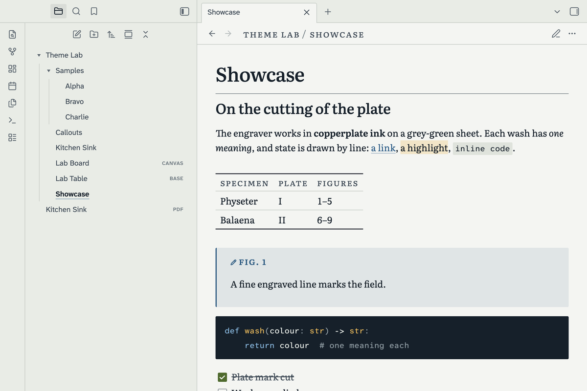
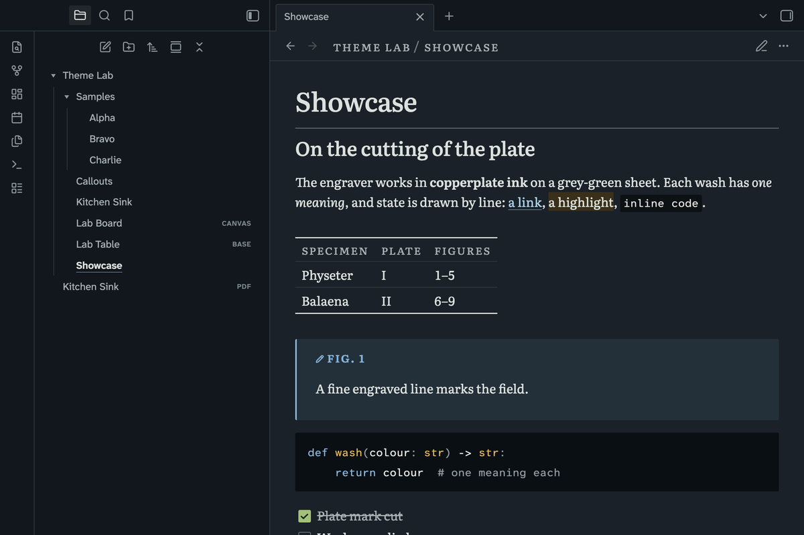
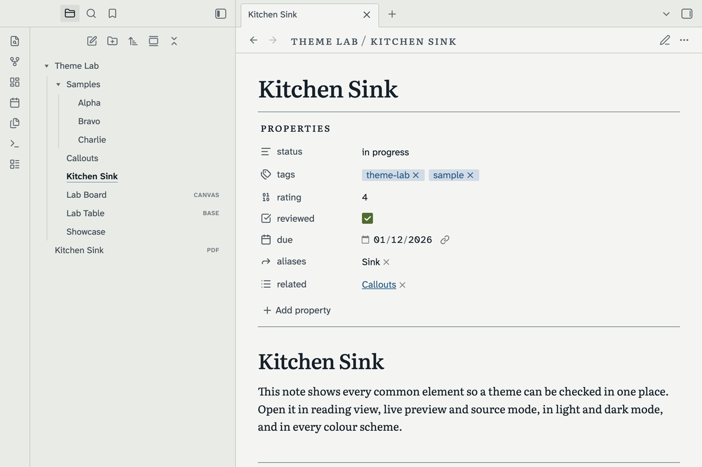
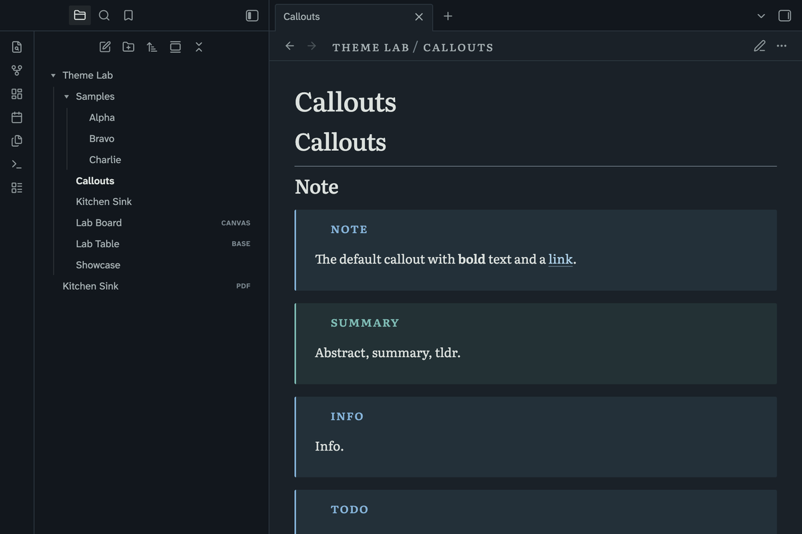
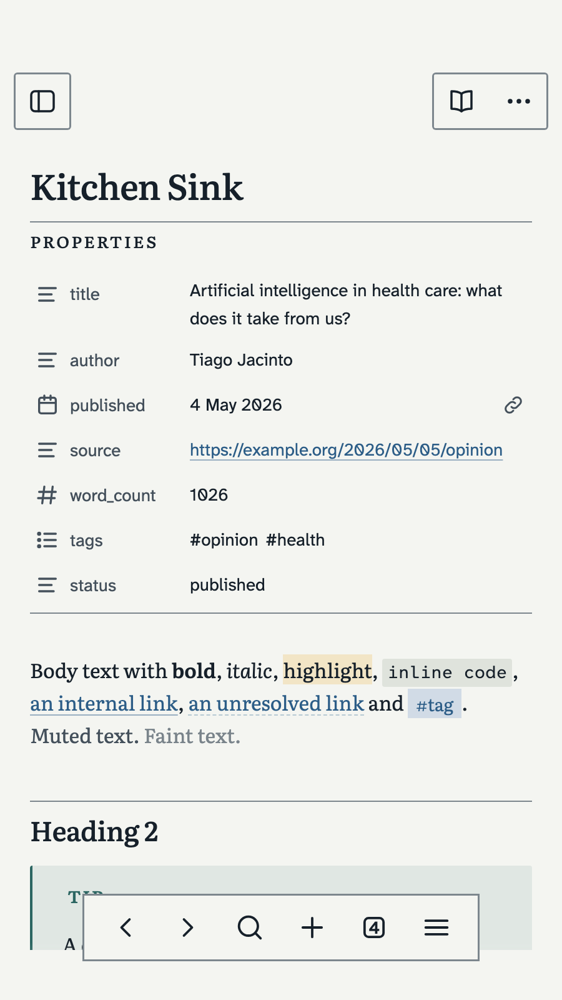
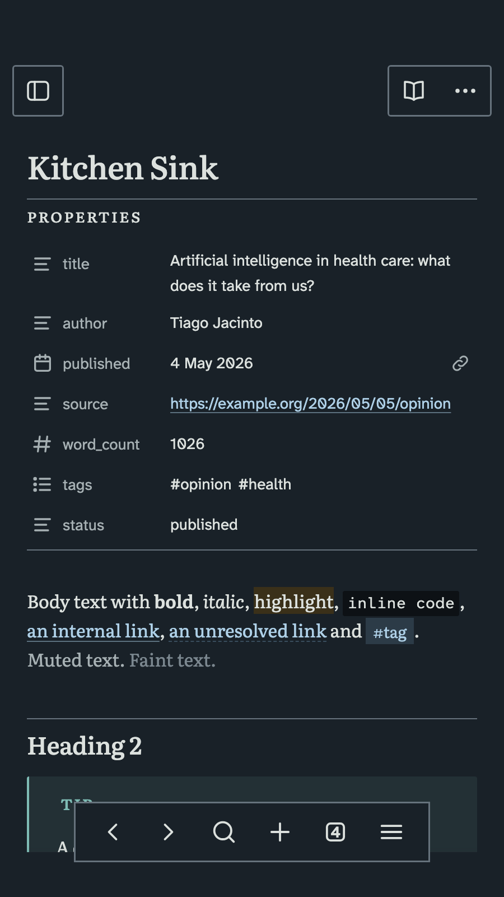
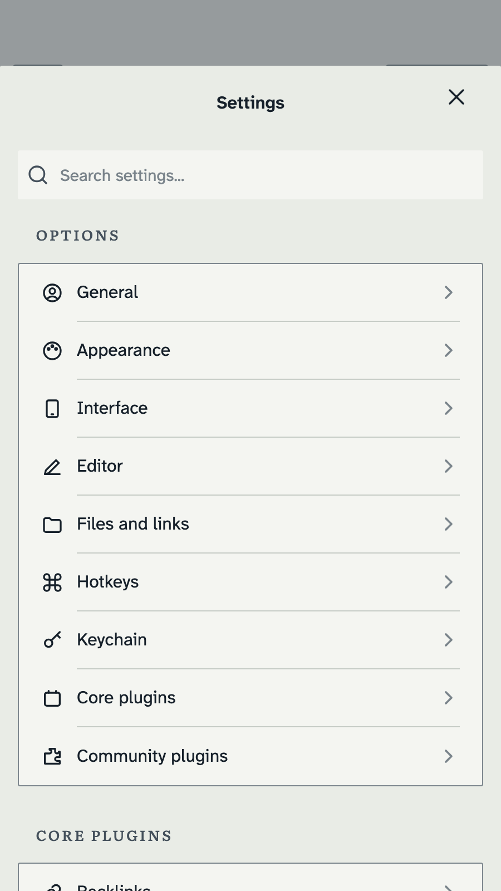

# Tryworks

Tryworks is an Obsidian theme drawn as an engraved natural-history plate. It has a grey-green sheet, a lighter plate field, copperplate ink and four washes as the only colour. Text is set in Literata. It works in light and dark mode, on desktop and on mobile.

The design follows [Tryworks](https://tryworks.tiagojacinto.eu) and [Sub-Sub](https://subsub.tiagojacinto.eu).

## What it looks like

- Corners are square on every platform, including macOS and mobile. Nothing has a shadow. Depth is a lighter field inside a fine plate mark.
- Tables are set as in a printed paper: a heavy rule above and below, small-capital heads, fine rules between rows.
- Callout titles and Properties headings are in small capitals. Callout icons are cut to the height of the capitals.
- Code blocks are an ink command block with mineral syntax colours.
- The note path is a running head above each note: small capitals over a fine rule.
- The file explorer is a printed index. Folders have a solid index mark. The open file is in ink with a fine accent underline.
- Properties are a ruled label: a plate mark above and below.
- Bases tables have no cell grid. Bases cards use serif titles and small-capital labels.
- The command palette marks the chosen row with a 2px accent edge.
- Four washes have one meaning each. Prussian blue is for links, focus and selection. Madder is for red callouts. Sap green is for checked items. Gamboge is for highlights and warnings.

## Mobile

Obsidian rounds many shapes on mobile and replaces the dark palette with pure black. Tryworks keeps its own colours and its square shapes on phones and tablets.

- The floating bars are solid plate fields with a fine mark. They have no blur and no pill shape.
- The Settings sheet and the grouped lists use plate marks and small-capital group titles.
- Touch targets keep Obsidian's size. Interface text follows the system text size.

## Colour schemes

| Scheme | Accent | Use |
| --- | --- | --- |
| Prussian (default) | Prussian blue | Links, focus, selection |
| Madder | Madder red | The same roles in red |

Select the scheme with the [Style Settings](https://github.com/obsidian-community/obsidian-style-settings) plugin. Without that plugin, the theme uses Prussian. The theme also follows Obsidian's accent colour setting.

## Style Settings options

- Readable line width.
- Text font: Literata or Atkinson Hyperlegible Next.
- Heading font: the text font, Literata or Atkinson Hyperlegible Next.
- Space above and below headings.
- Lining figures instead of oldstyle figures.
- Reading mode: larger type, wider leading and a 36rem measure.
- No rule above second-level headings.
- Plain note header: the note path in the interface font.
- Light code blocks instead of the ink command block.
- Callout titles in normal letters instead of small capitals.
- Chevrons on folders instead of the index marks.
- A filled background on the chosen file instead of the accent underline.

## Accessibility

Every text colour meets WCAG 2.1 AA contrast in both modes and both schemes. The focus outline is 2px in the accent colour. Animation respects the reduced-motion setting.

## Fonts

The fonts are embedded in `theme.css`, so they work offline and on every device. The theme makes no network calls.

- Literata for text.
- Atkinson Hyperlegible Next for the interface.
- Atkinson Hyperlegible Mono for code.

If you set a font in Settings, Appearance, your font wins.

## Install

From the community directory: open Settings, Appearance, Themes, Manage. Search for Tryworks and select Install and use.

Manual install: copy `manifest.json` and `theme.css` from the latest release into `<your vault>/.obsidian/themes/Tryworks/`. Then select the theme in Settings, Appearance.

## Compatibility

Requires Obsidian 1.13.4 or newer. The theme uses OKLCH colour mixing, which Obsidian supports from 1.13.4.

## Print and PDF

Print and PDF export use a white page. Code blocks on paper have a light field.

## Licence

Theme: MIT. See [LICENSE](LICENSE).

Fonts: Literata, Atkinson Hyperlegible Next and Atkinson Hyperlegible Mono, under the SIL Open Font License 1.1. See [fonts/OFL.txt](fonts/OFL.txt).

## Author

Tiago Jacinto, [tiagojacinto.eu](https://tiagojacinto.eu).
